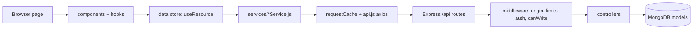
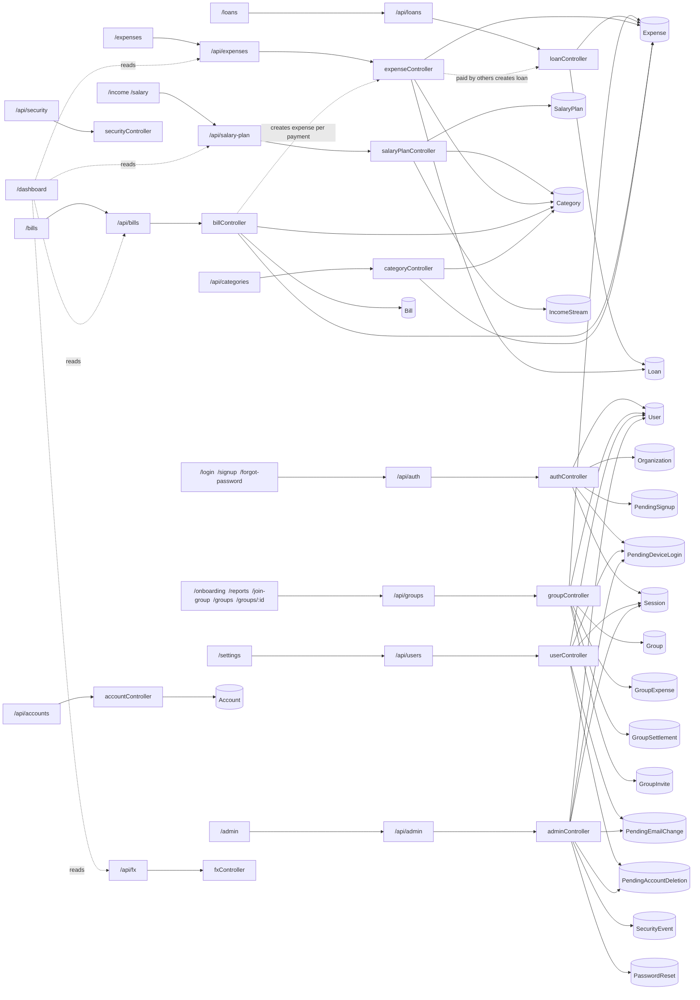

# APP-MAP (generated, do not edit by hand)

Built by `node docs/dev/make-app-map.mjs` from the real imports and routes (338 files). Rebuild it after every round. A new chat should read THIS file and CLAUDE.md, then open only the files named here for the feature being changed.

## 1. How data flows

## 2. Features at a glance (page -> service -> endpoints -> controller -> models)

## 3. Screens (route -> file -> what it pulls in)

- `/login` -> `frontend/src/pages/LoginPage.jsx`
  - components: AuthLayout, FormField, EmailField, Button, Captcha, GoogleAuthButton, PageLoader, LockScreen, LockTimerBadge, OtpInput, ErrorSlot
  - services: authService
  - utils: returnPath
- `/signup` -> `frontend/src/pages/SignupPage.jsx`
  - components: AuthLayout, FormField, EmailField, OtpInput, Button, Captcha, PasswordStrength, GoogleAuthButton, PageLoader, ErrorSlot
  - services: authService
  - utils: returnPath, emailRules, nameRules
- `/forgot-password` -> `frontend/src/pages/ForgotPasswordPage.jsx`
  - components: AuthLayout, EmailField, FormField, OtpInput, PasswordStrength, Button, Captcha, ErrorSlot
  - services: authService
  - utils: emailRules
- `/onboarding` -> `frontend/src/pages/OnboardingPage.jsx`
  - components: Button, Combobox, Logo, OptionTile, PhotoPicker, ProfilePreview, WelcomeScreen, StepIcons, ErrorSlot
  - services: userService
  - utils: returnPath, avatar
- `/dashboard` -> `frontend/src/pages/DashboardPage.jsx`
  - components: AppShell, useAppNav, BrandMark, BalanceCard, BillsPanel, MonthPulse, AttentionPanel, CashFlowPanel, CategoryPanel, LoansPanel, PlansPanel, RecentSpending, RupeeNote, Skeletons, incomeOptions
  - hooks/data: useBalance, useExpenseCategories, useResource
  - utils: incomeMath, balanceMath, dates, billMath, expenseMath, dashboardMath, reportMath
- `/income` -> `frontend/src/pages/IncomePage.jsx`
  - components: RupeeNote, Skeletons, AppShell, useAppNav, IncomeForm, incomeOptions, IncomeCard, IncomeDetail, BalanceOverview, OpeningBalanceSheet, Drawer
  - services: incomeStreamService
  - hooks/data: useBalance
  - utils: expenseMath, salaryCuts, incomeMath, useMediaQuery
- `/loans` -> `frontend/src/pages/LoansPage.jsx`
  - components: AppShell, useAppNav, Drawer, LoanForm, LoanCard, LoanDetail, Skeletons, LoansOverview
  - services: loanService
  - utils: incomeMath, loanMath, useMediaQuery
- `/expenses` -> `frontend/src/pages/ExpensesPage.jsx`
  - components: AppShell, useAppNav, Drawer, MonthOverview, categoryIcons, ExpenseForm, CategoryFilter, Skeletons, loanOptions
  - services: expenseService, loanService
  - utils: expenseMath
- `/bills` -> `frontend/src/pages/BillsPage.jsx`
  - components: AppShell, useAppNav, Drawer, Skeletons, BillRow, BillsSummary, BillFilter, BillDetail, BillForm, BillShare
  - services: billService
  - hooks/data: useMotionPreference, useExpenseCategories, useResource
  - utils: billers, billMath, billDates, dates, billPrefs
- `/salary` -> `frontend/src/pages/SalaryPage.jsx`
  - components: AppShell, useAppNav, AllocationForm, AllocationList, SalaryHistory, SalaryOverview, ui
  - services: salaryPlanService
  - hooks/data: useResource, useExpenseCategories, useMotionPreference
  - utils: expenseMath, salaryPlanMath
- `/reports` -> `frontend/src/pages/ReportsPage.jsx`
  - components: AppShell, useAppNav, Overview, Budgets, Goals, Accounts, Committees
  - hooks/data: useResource, useExpenseCategories
  - utils: expenseMath
- `/join-group` -> `frontend/src/pages/JoinGroupPage.jsx`
  - components: AppShell, useAppNav, GroupsIcon, GroupsHub
  - hooks/data: useGroupInvites
- `/groups` -> `frontend/src/pages/GroupsPage.jsx`
  - components: AppShell, useAppNav, GroupsHub, BalanceChips
- `/groups/:id` -> `frontend/src/pages/GroupPage.jsx`
  - components: AppShell, useAppNav, Drawer, GroupExpenseSheet, SettleSheet
  - services: groupService
  - utils: dates
- `/settings` -> `frontend/src/pages/SettingsPage.jsx`
  - components: AppShell, PeopleSection, DataSection, FormField, Button, Combobox, OtpInput, GoogleLinkButton, ErrorSlot
  - services: userService, authService, securityService
  - hooks/data: useGroupsNav, useMotionPreference, useSecureMode
  - utils: avatar, nameRules
- `/admin` -> `frontend/src/pages/AdminPage.jsx`
  - components: AppShell, Button, FormField, AdminPasswordPrompt
  - services: adminService, adminPassword
- other pages: 

## 4. API (what each service calls)

- `frontend/src/services/accountService.js`: GET /accounts | POST /accounts | PATCH /accounts/:id | DELETE /accounts/:id
- `frontend/src/services/adminService.js`: GET /admin/overview | GET /admin/users | GET /admin/users/:id | PATCH /admin/users/:id | POST /admin/users/:id/deactivate | POST /admin/users/:id/reactivate | DELETE /admin/users/:id | POST /admin/users/:id/force-password-reset | POST /admin/users/:id/disable-mfa | DELETE /admin/users/:id/sessions/:id | GET /admin/audit-log | GET /admin/security-overview | POST /admin/users/:id/unlock | GET /admin/users/export
- `frontend/src/services/authService.js`: POST /auth/signup | POST /auth/signup/verify | POST /auth/login | POST /auth/login-status | POST /auth/logout | POST /auth/refresh | GET /auth/me | POST /auth/google | POST /auth/link-google | POST /auth/unlink-google | POST /auth/verify-device | POST /auth/verify-mfa | POST /auth/validate-email | POST /auth/forgot-password | POST /auth/verify-reset-code | POST /auth/reset-password
- `frontend/src/services/billService.js`: GET /bills | POST /bills | PATCH /bills/:id | DELETE /bills/:id | POST /bills/:id/payments | DELETE /bills/:id/payments/:id | POST /bills/:id/cancel | POST /bills/:id/recurring
- `frontend/src/services/committeeService.js`: GET /committees | POST /committees | PUT /committees/:id | DELETE /committees/:id | POST /committees/:id/payments | DELETE /committees/:id/payments/:id | POST /committees/:id/payout | DELETE /committees/:id/payout
- `frontend/src/services/dataService.js`: GET /data/export/:id | POST /data/import/expenses | POST /data/import
- `frontend/src/services/expenseService.js`: GET /expenses | POST /expenses | PATCH /expenses/:id | DELETE /expenses/:id/receipt | DELETE /expenses/:id | GET /categories | POST /categories | PATCH /categories/:id | DELETE /categories/:id
- `frontend/src/services/fxService.js`: GET /fx/rates
- `frontend/src/services/groupService.js`: GET /groups | POST /groups | GET /groups/:id | DELETE /groups/:id | POST /groups/:id/leave | POST /groups/join | POST /groups/:id/invites | DELETE /groups/:id/invites/:id | POST /groups/:id/expenses | PATCH /groups/:id/expenses/:id | DELETE /groups/:id/expenses/:id | POST /groups/:id/expenses/:id/my-expenses | POST /groups/:id/settlements | DELETE /groups/:id/settlements/:id | GET /groups/invites/mine | POST /groups/invites/:id/accept | DELETE /groups/invites/:id
- `frontend/src/services/incomeStreamService.js`: GET /income-streams | POST /income-streams | PATCH /income-streams/:id | DELETE /income-streams/:id
- `frontend/src/services/loanService.js`: GET /loans | POST /loans | PATCH /loans/:id | DELETE /loans/:id | POST /loans/:id/payments | DELETE /loans/:id/payments/:id | DELETE /loans/:id/received-proof | DELETE /loans/:id/payments/:id/proof
- `frontend/src/services/planningService.js`: GET /budgets | PUT /budgets | DELETE /budgets/:id | GET /goals | POST /goals | PUT /goals/:id | DELETE /goals/:id | POST /goals/:id/contributions | DELETE /goals/:id/contributions/:id
- `frontend/src/services/receiptService.js`: GET /receipts | POST /receipts | PATCH /receipts/:id | DELETE /receipts/:id | GET /receipts/opening | PUT /receipts/opening | GET /expenses/totals
- `frontend/src/services/salaryPlanService.js`: GET /salary-plan/:id | PUT /salary-plan/:id | GET /salary-plan
- `frontend/src/services/securityService.js`: POST /security/events
- `frontend/src/services/teamService.js`: GET /team | POST /team/invites | DELETE /team/invites/:id | POST /team/join | POST /team/leave | PATCH /team/members/:id | DELETE /team/members/:id
- `frontend/src/services/userService.js`: PATCH /users/me | POST /users/me/password | POST /users/me/avatar | GET /users/me/sessions | DELETE /users/me/sessions/:id | POST /users/me/sessions/logout-all | POST /users/me/email/request-change | POST /users/me/email/verify-change | POST /users/me/delete/request | POST /users/me/delete/confirm | POST /users/me/mfa/setup | POST /users/me/mfa/confirm | POST /users/me/mfa/disable

## 5. Backend routes -> controller -> models and helpers

### /api/auth
- controller `backend/src/controllers/authController.js`; models: User, Organization, PendingSignup, PendingDeviceLogin, Session; helpers: tokens, emailValidation, disposableDomains, validators, securityLog, mailer, mailTemplates, deviceLabel, mfaCrypto, cooldown, deviceLimit
- POST /api/auth/signup
- POST /api/auth/signup/verify
- POST /api/auth/login
- POST /api/auth/verify-device
- POST /api/auth/verify-mfa
- POST /api/auth/login-status
- POST /api/auth/logout
- POST /api/auth/google
- POST /api/auth/link-google
- POST /api/auth/unlink-google
- POST /api/auth/google/callback
- POST /api/auth/refresh
- GET /api/auth/me
- POST /api/auth/validate-email
- POST /api/auth/forgot-password
- POST /api/auth/verify-reset-code
- POST /api/auth/reset-password
### /api/users
- controller `backend/src/controllers/userController.js`; models: User, Session, PendingEmailChange, PendingDeviceLogin, PendingAccountDeletion; helpers: organizations, groups, tokens, deviceLabel, imageStorage, validators, emailValidation, disposableDomains, securityLog, mailer, mailTemplates, cooldown
- PATCH /api/users/me
- POST /api/users/me/password
- POST /api/users/me/avatar
- GET /api/users/me/sessions
- DELETE /api/users/me/sessions/:id
- POST /api/users/me/sessions/logout-all
- POST /api/users/me/email/request-change
- POST /api/users/me/email/verify-change
- POST /api/users/me/delete/request
- POST /api/users/me/delete/confirm
- POST /api/users/me/mfa/setup
- POST /api/users/me/mfa/confirm
- POST /api/users/me/mfa/disable
### /api/security
- controller `backend/src/controllers/securityController.js`; models: none; helpers: securityLog
- POST /api/security/events
### /api/admin
- controller `backend/src/controllers/adminController.js`; models: User, Session, SecurityEvent, PasswordReset, PendingEmailChange, PendingDeviceLogin, PendingAccountDeletion; helpers: deviceLabel, cooldown, validators, emailValidation, mailer, mailTemplates, securityLog, organizations, groups
- GET /api/admin/overview
- GET /api/admin/audit-log
- GET /api/admin/security-overview
- GET /api/admin/users/export
- GET /api/admin/users
- GET /api/admin/users/:id
- PATCH /api/admin/users/:id
- POST /api/admin/users/:id/deactivate
- POST /api/admin/users/:id/reactivate
- POST /api/admin/users/:id/unlock
- DELETE /api/admin/users/:id
- POST /api/admin/users/:id/force-password-reset
- POST /api/admin/users/:id/disable-mfa
- DELETE /api/admin/users/:id/sessions/:sessionId
### /api/accounts
- controller `backend/src/controllers/accountController.js`; models: Account; helpers: validators
- GET /api/accounts
- POST /api/accounts  (write)
- PATCH /api/accounts/:id  (write)
- DELETE /api/accounts/:id  (write)
### /api/categories
- controller `backend/src/controllers/categoryController.js`; models: Category, Expense; helpers: validators, categoryIcons
- GET /api/categories
- POST /api/categories  (write)
- PATCH /api/categories/:id  (write)
- DELETE /api/categories/:id  (write)
### /api/income-streams
- controller `backend/src/controllers/incomeStreamController.js`; models: IncomeReceipt, IncomeStream; helpers: validators
- GET /api/income-streams
- POST /api/income-streams  (write)
- PATCH /api/income-streams/:id  (write)
- DELETE /api/income-streams/:id  (write)
### /api/fx
- controller `backend/src/controllers/fxController.js`; models: none; helpers: exchangeRateService, validators
- GET /api/fx/rates
### /api/loans
- controller `backend/src/controllers/loanController.js`; models: Loan, Expense; helpers: expenseLoanLink, validators, financeInput, imageStorage
- GET /api/loans
- POST /api/loans  (write)
- PATCH /api/loans/:id  (write)
- DELETE /api/loans/:id  (write)
- POST /api/loans/:id/payments  (write)
- DELETE /api/loans/:id/payments/:paymentId  (write)
- POST /api/loans/:id/received-proof  (write)
- DELETE /api/loans/:id/received-proof  (write)
- POST /api/loans/:id/payments/:paymentId/proof  (write)
- DELETE /api/loans/:id/payments/:paymentId/proof  (write)
### /api/expenses
- controller `backend/src/controllers/expenseController.js`; models: Expense, Category, Loan; helpers: validators, expenseLoanLink, financeInput, expenseRepeat, billRecurrence, balanceTotals, imageStorage
- GET /api/expenses/totals
- GET /api/expenses
- POST /api/expenses  (write)
- PATCH /api/expenses/:id  (write)
- DELETE /api/expenses/:id  (write)
- POST /api/expenses/:id/receipt  (write)
- DELETE /api/expenses/:id/receipt  (write)
### /api/salary-plan
- controller `backend/src/controllers/salaryPlanController.js`; models: SalaryPlan, Category, IncomeStream; helpers: financeInput, currencies
- GET /api/salary-plan
- GET /api/salary-plan/:month
- PUT /api/salary-plan/:month
### /api/budgets
### /api/goals
### /api/committees
- controller `backend/src/controllers/committeeController.js`; models: Committee; helpers: financeInput, currencies, committee
- GET /api/committees
- POST /api/committees
- PUT /api/committees/:id
- PATCH /api/committees/:id
- DELETE /api/committees/:id
- POST /api/committees/:id/payments
- DELETE /api/committees/:id/payments/:round
- POST /api/committees/:id/payout
- DELETE /api/committees/:id/payout
### /api/bills
- controller `backend/src/controllers/billController.js`; models: Bill, Expense, Category; helpers: billRecurrence, validators, financeInput
- GET /api/bills
- POST /api/bills  (write)
- PATCH /api/bills/:id  (write)
- DELETE /api/bills/:id  (write)
- POST /api/bills/:id/payments  (write)
- DELETE /api/bills/:id/payments/:paymentId  (write)
- POST /api/bills/:id/cancel  (write)
- POST /api/bills/:id/recurring  (write)
### /api/receipts
- controller `backend/src/controllers/receiptController.js`; models: IncomeReceipt, IncomeStream, Organization; helpers: validators, financeInput
- GET /api/receipts/opening
- PUT /api/receipts/opening  (write)
- GET /api/receipts
- POST /api/receipts  (write)
- PATCH /api/receipts/:id  (write)
- DELETE /api/receipts/:id  (write)
### /api/data
- controller `backend/src/controllers/dataController.js`; models: Expense, Category, Bill, Loan, IncomeReceipt, IncomeStream; helpers: csv, validators, financeInput
- GET /api/data/export/:kind
- POST /api/data/import/expenses
- POST /api/data/import
### /api/team
- controller `backend/src/controllers/teamController.js`; models: User, Organization, Invite, IncomeStream, IncomeReceipt, Expense, Bill, Loan, Category; helpers: mailer, mailTemplates, emailValidation, organizations
- GET /api/team
- POST /api/team/invites
- DELETE /api/team/invites/:id
- POST /api/team/join
- POST /api/team/leave
- PATCH /api/team/members/:id
- DELETE /api/team/members/:id
### /api/groups
- controller `backend/src/controllers/groupController.js`; models: Group, GroupExpense, GroupSettlement, GroupInvite, User, Expense; helpers: mailer, mailTemplates, emailValidation, validators, financeInput, groupMath, groups, groupRepeat
- GET /api/groups
- POST /api/groups
- POST /api/groups/join
- GET /api/groups/invites/mine
- POST /api/groups/invites/:inviteId/accept
- DELETE /api/groups/invites/:inviteId
- GET /api/groups/:id
- PATCH /api/groups/:id
- DELETE /api/groups/:id
- POST /api/groups/:id/leave
- POST /api/groups/:id/invites
- DELETE /api/groups/:id/invites/:inviteId
- POST /api/groups/:id/expenses
- PATCH /api/groups/:id/expenses/:expenseId
- DELETE /api/groups/:id/expenses/:expenseId
- POST /api/groups/:id/expenses/:expenseId/my-expenses  (write)
- POST /api/groups/:id/settlements
- DELETE /api/groups/:id/settlements/:settlementId

## 6. Data store (frontend/src/data/resources.js)

- resource `bills`
- resource `expenses`
- resource `loans`
- resource `categories`
- resource `salaryPlan`
- resource `salaryPlans`
- resource `budgets`
- resource `accounts`
- resource `committees`
- resource `goals`
- resource `receipts`
- resource `opening`
- resource `expenseTotals`
- resource `rates`
- a save to `/bills` reloads bills, expenses, expenseTotals
- a save to `/expenses` reloads expenses, expenseTotals
- a save to `/categories` reloads categories, expenses, bills
- a save to `/loans` reloads loans, expenses, expenseTotals
- a save to `/income-streams` reloads receipts
- a save to `/salary-plan` reloads salaryPlan, salaryPlans
- a save to `/budgets` reloads budgets
- a save to `/goals` reloads goals
- a save to `/committees` reloads committees
- a save to `/accounts` reloads accounts
- a save to `/receipts` reloads receipts, opening, expenseTotals

## 7. Models (field names)

- `Account`: orgId, name, type, currency, balanceMinor, color, isArchived, createdBy
- `Bill`: amountMinor, paidAt, payMethod, payName, note, expenseId, seq, dueAt, periodStart, periodEnd, nextBillAt, orgId, createdBy, billerName, billerId, categoryId, amountMinor, installationMinor, currency, dueAt, periodStart, periodEnd, billerAccount, payMethod, payName, note, frequency, seriesState
- `Budget`: orgId, categoryId, amountMinor, currency
- `Category`: orgId, name, type, color, icon, isArchived, isDefault, createdBy
- `Committee`: round, paidAt, amountMinor, orgId, createdBy, name, currency, contributionMinor, size, frequency, startDate, mySlot, paid, payoutReceivedAt
- `Expense`: orgId, createdBy, amountMinor, currency, categoryId, spentAt, note, receipt, payMethod, payName, paidBy, payerName, givenTo, billId, billPaymentId, loanId, groupExpenseId, repeatFrequency, repeatAnchor, repeatStep, repeatOf, repeatKey
- `Goal`: amountMinor, date, note, orgId, name, targetMinor, currency, deadline, contributions
- `Group`: userId, name, joinedAt, left, name, currency, createdBy, members
- `GroupExpense`: userId, amountMinor, percentBp, groupId, createdBy, description, amountMinor, currency, spentAt, paidBy, splitType, shares, repeatFrequency, repeatAnchor, repeatStep, repeatOf, repeatKey
- `GroupInvite`: groupId, invitedBy, email, codeHash, expiresAt
- `GroupSettlement`: groupId, createdBy, fromUserId, toUserId, amountMinor, currency, paidAt, note
- `IncomeReceipt`: orgId, streamId, receivedAt, amountMinor, currency, note, source, createdBy
- `IncomeStream`: orgId, name, incomeType, typeDetail, payerName, receivedAt, taxEnabled, deductionsEnabled, deductFromTotal, deductions, frequency, destinationMethod, destinationName, expectedAmountMinor, currency, isArchived, createdBy
- `Invite`: orgId, invitedBy, email, role, codeHash, expiresAt
- `Loan`: publicId, version, amountMinor, paidAt, note, proof, orgId, createdBy, direction, personName, amountMinor, scale, currency, sentAt, dueAt, note, receivedMethod, receivedName, receivedProof, payoutName, payoutMethod, payoutInstitution, payoutNumber, payments, source
- `Organization`: name, ownerId, openingBalanceMinor, openingBalanceCurrency, openingBalanceAsOf, receiptsBackfilled
- `PasswordReset`: email, userId, otpHash, otpExpiresAt, attempts, sendCount, windowStartedAt, lastSentAt, verified, resetNonce, resetExpiresAt, expiresAt
- `PendingAccountDeletion`: userId, otpHash, otpExpiresAt, attempts, sendCount, windowStartedAt, lastSentAt, expiresAt
- `PendingDeviceLogin`: userId, otpHash, otpExpiresAt, attempts, sendCount, windowStartedAt, lastSentAt, userAgent, ip, expiresAt
- `PendingEmailChange`: userId, newEmail, oldEmailOtpHash, newEmailOtpHash, otpExpiresAt, attempts, sendCount, windowStartedAt, lastSentAt, expiresAt
- `PendingSignup`: email, name, passwordHash, otpHash, otpExpiresAt, attempts, sendCount, windowStartedAt, lastSentAt, expiresAt, deviceId, deviceFallbackId
- `SalaryPlan`: label, amountMinor, categoryId, kind, orgId, month, streamId, lines, detached, salaryMinor, currency
- `SecurityEvent`: event, userId, ip, path, details, capped
- `Session`: 
- `User`: orgId, name, email, passwordHash, authProvider, googleId, role, plan, country, currency, language, avatarUrl, avatarPublicId, onboardingCompleted, reminderEmails, lastReminderEmailOn, mfaEnabled, mfaSecret, mfaBackupCodes, usernameChangedAt, emailChangedAt, nameHistory, emailHistory, googleUnlinkedAt, tokenVersion, failedLoginAttempts, lockUntil, lockTier

## 8. Where is it used (most connected files: change with care)

- `frontend/src/i18n/useTranslation.js` is imported by 103 files
- `frontend/src/i18n/useFormat.js` is imported by 49 files
- `frontend/src/context/AuthContext.jsx` is imported by 38 files
- `frontend/src/hooks/useMotionPreference.js` is imported by 32 files
- `frontend/src/i18n/notifications.js` is imported by 32 files
- `frontend/src/utils/dates.js` is imported by 25 files
- `frontend/src/components/Combobox.jsx` is imported by 19 files
- `backend/src/middleware/rateLimiters.js` is imported by 19 files
- `frontend/src/services/api.js` is imported by 18 files
- `backend/src/middleware/auth.js` is imported by 18 files
- `frontend/src/components/FormField.jsx` is imported by 16 files
- `frontend/src/services/apiError.js` is imported by 16 files
- `frontend/src/components/Button.jsx` is imported by 15 files
- `backend/src/utils/validators.js` is imported by 15 files
- `frontend/src/data/useResource.js` is imported by 14 files

## 9. File index by feature (one line each)

### accounts
- `backend/src/controllers/accountController.js`  (used by 1)
- `backend/src/models/Account.js` - What the user calls a "money stream" - a bank account, cash, a card, a  (used by 2)
- `backend/src/models/PendingAccountDeletion.js` - One pending row per user who confirmed their password (or typed DELETE,  (used by 2)
- `backend/src/routes/accountRoutes.js` - Any signed-in org member can read (including a viewer) - writes need  (used by 1)
- `frontend/src/components/layout/AccountMenu.jsx`  (used by 1)
- `frontend/src/components/reports/Accounts.jsx`  (used by 1)
- `frontend/src/services/accountService.js`  (used by 2)
### admin
- `backend/src/controllers/adminController.js`  (used by 1)
- `backend/src/middleware/requireAdmin.js` - Must run after authenticate() - relies on req.user already being set.  (used by 1)
- `backend/src/routes/adminRoutes.js`  (used by 1)
- `frontend/src/components/RequireAdmin.jsx` - This is a UX nicety only (bounces a non-admin straight to the dashboard  (used by 2)
- `frontend/src/pages/AdminPage.jsx` - Admin Dashboard - restricted to ADMIN_EMAIL (see RequireAdmin.jsx and  (used by 1)
- `frontend/src/services/adminService.js`  (used by 1)
### auth
- `backend/src/controllers/authController.js`  (used by 1)
- `backend/src/controllers/mfaController.js`  (used by 1)
- `backend/src/controllers/passwordResetController.js`  (used by 1)
- `backend/src/middleware/auth.js`  (used by 18)
- `backend/src/middleware/requireAdminPassword.js`  (used by 1)
- `backend/src/models/PasswordReset.js`  (used by 2)
- `backend/src/models/PendingDeviceLogin.js` - One pending row per user who hit the 2-device sign-in limit and needs to  (used by 3)
- `backend/src/models/PendingSignup.js`  (used by 1)
- `backend/src/routes/authRoutes.js`  (used by 1)
- `backend/src/utils/mfaCrypto.js` - A TOTP secret has to be reversible (it's needed in plaintext to check a  (used by 2)
- `frontend/src/components/AuthLayout.jsx`  (used by 3)
- `frontend/src/components/AuthVisual.jsx`  (used by 1)
- `frontend/src/components/GoogleAuthButton.jsx` - Popup mode (the library's default: no ux_mode/login_uri), the same pattern  (used by 2)
- `frontend/src/components/GoogleLinkButton.jsx` - Unlike GoogleAuthButton (used on the login/signup pages), this one stays  (used by 1)
- `frontend/src/components/OtpInput.jsx`  (used by 4)
- `frontend/src/components/PasswordStrength.jsx`  (used by 2)
- `frontend/src/components/admin/AdminPasswordPrompt.jsx`  (used by 1)
- `frontend/src/context/AuthContext.jsx`  (used by 38)
- `frontend/src/pages/ForgotPasswordPage.jsx`  (used by 1)
- `frontend/src/pages/LoginPage.jsx`  (used by 1)
- `frontend/src/pages/SignupPage.jsx`  (used by 1)
- `frontend/src/services/adminPassword.js`  (used by 2)
- `frontend/src/services/authService.js`  (used by 6)
### bills
- `backend/src/controllers/billController.js`  (used by 1)
- `backend/src/models/Bill.js`  (used by 5)
- `backend/src/routes/billRoutes.js`  (used by 1)
- `backend/src/utils/billRecurrence.js`  (used by 5)
- `frontend/src/components/bills/BillDetail.jsx`  (used by 1)
- `frontend/src/components/bills/BillFilter.jsx`  (used by 1)
- `frontend/src/components/bills/BillForm.jsx`  (used by 1)
- `frontend/src/components/bills/BillPayForm.jsx`  (used by 1)
- `frontend/src/components/bills/BillRow.jsx` - One bill in the list. The whole row opens the bill; "Pay" is its own button  (used by 1)
- `frontend/src/components/bills/BillShare.jsx`  (used by 1)
- `frontend/src/components/bills/BillStatus.jsx`  (used by 2)
- `frontend/src/components/bills/BillsSummary.jsx`  (used by 1)
- `frontend/src/components/dashboard/BillsPanel.jsx`  (used by 1)
- `frontend/src/pages/BillsPage.jsx`  (used by 1)
- `frontend/src/services/billService.js`  (used by 2)
- `frontend/src/utils/billDates.js`  (used by 2)
- `frontend/src/utils/billMath.js`  (used by 8)
- `frontend/src/utils/billPdf.js`  (used by 1)
- `frontend/src/utils/billPrefs.js` - Remembers what you chose last time so entering many bills is quick.  (used by 2)
- `frontend/src/utils/billers.js` - Companies people in Pakistan pay bills to. `domains` is used to fetch the  (used by 5)
### categories
- `backend/src/controllers/categoryController.js`  (used by 1)
- `backend/src/models/Category.js` - Not wired into any UI yet (that's the Transactions phase) - created now  (used by 8)
- `backend/src/routes/categoryRoutes.js`  (used by 1)
- `backend/src/utils/categoryIcons.js`  (used by 1)
- `frontend/src/components/bills/NewCategorySheet.jsx`  (used by 0)
- `frontend/src/components/dashboard/CategoryPanel.jsx` - Where this month's own spending went. Rows with a budget show how much of it is left.  (used by 1)
- `frontend/src/components/expenses/CategoryFilter.jsx` - A filter icon in the corner of the list. Opens a small menu of the categories  (used by 1)
- `frontend/src/components/expenses/CategoryPicker.jsx`  (used by 1)
- `frontend/src/components/expenses/categoryIcons.jsx`  (used by 6)
### dashboard
- `frontend/src/pages/DashboardPage.jsx`  (used by 1)
- `frontend/src/utils/dashboardMath.js` - Where the month stands today. `spent` is what I paid myself this month and  (used by 2)
### expenses
- `backend/src/controllers/expenseController.js`  (used by 1)
- `backend/src/models/Expense.js`  (used by 10)
- `backend/src/models/GroupExpense.js`  (used by 3)
- `backend/src/routes/expenseRoutes.js`  (used by 1)
- `backend/src/utils/expenseLoanLink.js`  (used by 2)
- `backend/src/utils/expenseRepeat.js` - Makes the copies of repeating expenses that are due up to `now` (inclusive).  (used by 1)
- `frontend/src/components/expenses/ExpenseForm.jsx`  (used by 1)
- `frontend/src/components/groups/GroupExpenseSheet.jsx`  (used by 1)
- `frontend/src/hooks/useExpenseCategories.js`  (used by 4)
- `frontend/src/pages/ExpensesPage.jsx`  (used by 1)
- `frontend/src/services/expenseService.js`  (used by 4)
- `frontend/src/utils/expenseMath.js`  (used by 13)
### income
- `backend/src/controllers/incomeStreamController.js`  (used by 1)
- `backend/src/controllers/salaryPlanController.js`  (used by 1)
- `backend/src/models/IncomeReceipt.js` - One real payment that came in (a salary on 1 Nov, a freelance invoice paid on  (used by 5)
- `backend/src/models/IncomeStream.js` - Where money comes FROM, as distinct from an Account (where it lands).  (used by 6)
- `backend/src/models/SalaryPlan.js` - Optional: real expenses in this category count as "spent" on this line.  (used by 2)
- `backend/src/routes/incomeStreamRoutes.js`  (used by 1)
- `backend/src/routes/salaryPlanRoutes.js`  (used by 1)
- `frontend/src/components/income/IncomeCard.jsx`  (used by 1)
- `frontend/src/components/income/IncomeDetail.jsx`  (used by 1)
- `frontend/src/components/income/IncomeForm.jsx`  (used by 1)
- `frontend/src/components/income/SalaryCutsPanel.jsx`  (used by 1)
- `frontend/src/components/income/incomeOptions.js`  (used by 5)
- `frontend/src/components/salary/SalaryHistory.jsx`  (used by 1)
- `frontend/src/components/salary/SalaryOverview.jsx`  (used by 1)
- `frontend/src/context/IncomeContext.jsx`  (used by 11)
- `frontend/src/pages/IncomePage.jsx`  (used by 1)
- `frontend/src/pages/SalaryPage.jsx`  (used by 1)
- `frontend/src/services/incomeStreamService.js` - Always asks for archived streams too: the balance still needs them for old receipts.  (used by 2)
- `frontend/src/services/salaryPlanService.js`  (used by 2)
- `frontend/src/utils/incomeMath.js`  (used by 8)
- `frontend/src/utils/salaryCuts.js`  (used by 7)
- `frontend/src/utils/salaryPlanMath.js` - What a stream brings in per month after tax and deductions.  (used by 3)
- `frontend/src/utils/taxRules.js`  (used by 2)
### loans
- `backend/src/controllers/loanController.js`  (used by 1)
- `backend/src/models/Loan.js`  (used by 8)
- `backend/src/routes/loanRoutes.js`  (used by 1)
- `frontend/src/components/dashboard/LoansPanel.jsx`  (used by 1)
- `frontend/src/components/loans/LoanAmounts.jsx`  (used by 2)
- `frontend/src/components/loans/LoanCard.jsx`  (used by 1)
- `frontend/src/components/loans/LoanDetail.jsx`  (used by 1)
- `frontend/src/components/loans/LoanForm.jsx`  (used by 1)
- `frontend/src/components/loans/LoansOverview.jsx`  (used by 1)
- `frontend/src/components/loans/loanOptions.js`  (used by 9)
- `frontend/src/components/loans/loanStatus.js`  (used by 2)
- `frontend/src/pages/LoansPage.jsx`  (used by 1)
- `frontend/src/services/loanService.js`  (used by 3)
- `frontend/src/utils/loanMath.js`  (used by 8)
### rates
- `backend/src/controllers/fxController.js`  (used by 1)
- `backend/src/middleware/rateLimiters.js` - Outside production (local dev, the e2e suite, manual QA against a dev  (used by 19)
- `backend/src/routes/fxRoutes.js`  (used by 1)
- `backend/src/services/exchangeRateService.js`  (used by 1)
- `frontend/src/services/fxService.js`  (used by 1)
### security
- `backend/src/controllers/securityController.js`  (used by 1)
- `backend/src/middleware/security.js`  (used by 1)
- `backend/src/models/SecurityEvent.js` - A capped collection: Mongo automatically discards the oldest documents once  (used by 2)
- `backend/src/models/Session.js` - One row per signed-in device/browser. The row's own _id is used as the  (used by 5)
- `backend/src/routes/securityRoutes.js`  (used by 1)
- `backend/src/utils/securityLog.js` - Fire-and-forget: never let a logging failure affect the request that  (used by 10)
- `frontend/src/components/security/SecureBadge.jsx`  (used by 1)
- `frontend/src/components/security/SecureGuard.jsx`  (used by 1)
- `frontend/src/hooks/useSecureMode.js`  (used by 3)
- `frontend/src/portfolio/components/Security.jsx`  (used by 1)
- `frontend/src/services/securityService.js`  (used by 2)
### settings
- `backend/src/controllers/userController.js`  (used by 1)
- `backend/src/models/User.js`  (used by 12)
- `backend/src/routes/userRoutes.js`  (used by 1)
- `frontend/src/data/useResource.js`  (used by 14)
- `frontend/src/hooks/useReminders.js` - Bills and loans that are overdue or due within a week. Shared by the bell in  (used by 1)
- `frontend/src/pages/SettingsPage.jsx`  (used by 1)
- `frontend/src/services/userService.js`  (used by 2)
- `frontend/src/utils/avatar.js`  (used by 8)
### shared
- `backend/src/app.js`  (used by 1)
- `backend/src/config/cloudinary.js`  (used by 7)
- `backend/src/config/database.js`  (used by 1)
- `backend/src/config/env.js` - The one account allowed into the Admin Dashboard (see  (used by 3)
- `backend/src/controllers/committeeController.js`  (used by 1)
- `backend/src/controllers/dataController.js`  (used by 1)
- `backend/src/controllers/groupController.js`  (used by 1)
- `backend/src/controllers/planningController.js`  (used by 1)
- `backend/src/controllers/receiptController.js`  (used by 1)
- `backend/src/controllers/teamController.js`  (used by 1)
- `backend/src/middleware/captcha.js`  (used by 3)
- `backend/src/middleware/deviceId.js` - Identifies "this device" well enough to cap how many accounts can be  (used by 1)
- `backend/src/middleware/errorHandler.js`  (used by 1)
- `backend/src/middleware/originGuard.js`  (used by 1)
- `backend/src/middleware/upload.js`  (used by 4)
- `backend/src/models/Budget.js` - A monthly spending limit for one expense category.  (used by 2)
- `backend/src/models/Committee.js` - A committee (kameti / ROSCA): `size` people each put in `contributionMinor` every period, and each  (used by 2)
- `backend/src/models/Goal.js` - Positive = money put in, negative = money taken out.  (used by 2)
- `backend/src/models/Group.js` - A shared group (flatmates, a trip). People keep their own private workspace;  (used by 3)
- `backend/src/models/GroupInvite.js`  (used by 2)
- `backend/src/models/GroupSettlement.js` - "Sara paid Ali 1500": clears part of what Sara owes in the group.  (used by 2)
- `backend/src/models/Invite.js` - One invitation to join a workspace. The code is only stored as a hash; the  (used by 2)
- `backend/src/models/Organization.js` - Money the person already had when they started. 0 means "start from zero".  (used by 4)
- `backend/src/models/PendingEmailChange.js` - One pending row per user mid-way through changing their email. Two codes  (used by 2)
- `backend/src/routes/committeeRoutes.js`  (used by 1)
- `backend/src/routes/dataRoutes.js`  (used by 1)
- `backend/src/routes/groupRoutes.js`  (used by 1)
- `backend/src/routes/planningRoutes.js`  (used by 1)
- `backend/src/routes/receiptRoutes.js`  (used by 1)
- `backend/src/routes/teamRoutes.js`  (used by 1)
- `backend/src/server.js`  (used by 0)
- `backend/src/services/imageStorage.js`  (used by 5)
- `backend/src/services/reminderDigest.js` - Reminder emails. One digest per person per day, only when something is  (used by 1)
- `backend/src/utils/backupCodes.js` - Excludes visually-confusable characters (0/O, 1/I/L) so a code is easy to  (used by 1)
- `backend/src/utils/balanceTotals.js` - Pure helpers for the balance totals endpoint. Kept free of database calls so  (used by 1)
- `backend/src/utils/committee.js` - Dates and status of a committee. Everything works on whole days (UTC) so a round never moves  (used by 1)
- `backend/src/utils/cooldown.js` - Shared cooldown helpers for anything that locks for N days after a change  (used by 3)
- `backend/src/utils/csv.js` - CSV helpers. Cells that start with = + - @ (or a tab / carriage return) get a  (used by 1)
- `backend/src/utils/currencies.js`  (used by 5)
- `backend/src/utils/decimalMoney.js`  (used by 0)
- `backend/src/utils/deviceLabel.js` - Turns a raw User-Agent string into something a person can recognize at a  (used by 3)
- `backend/src/utils/deviceLimit.js` - How many Vaultrix accounts a single device is allowed to create, counting  (used by 1)
- `backend/src/utils/disposableDomains.js`  (used by 4)
- `backend/src/utils/emailValidation.js`  (used by 6)
- `backend/src/utils/financeInput.js`  (used by 10)
- `backend/src/utils/groupMath.js` - Pure maths for shared groups (rent, food, trips). Money is whole minor units.  (used by 1)
- `backend/src/utils/groupRepeat.js` - Makes the copies of repeating shared costs (monthly rent...) that are due up to `now`.  (used by 1)
- `backend/src/utils/groups.js` - When an account is deleted it leaves every group (balances stay, under the old name).  (used by 3)
- `backend/src/utils/mailTemplates.js`  (used by 6)
- `backend/src/utils/mailer.js`  (used by 7)
- `backend/src/utils/organizations.js`  (used by 4)
- `backend/src/utils/tokens.js` - sessionId is optional only for backward compatibility with any  (used by 5)
- `backend/src/utils/validators.js` - Letters (any script, via \p{L}) and combining marks (accents, via \p{M}), plus  (used by 15)
- `frontend/src/App.jsx`  (used by 1)
- `frontend/src/components/AlertBanner.jsx`  (used by 1)
- `frontend/src/components/AnimatedAmount.jsx`  (used by 3)
- `frontend/src/components/BrandMark.jsx`  (used by 12)
- `frontend/src/components/Button.jsx`  (used by 15)
- `frontend/src/components/Captcha.jsx`  (used by 3)
- `frontend/src/components/Combobox.jsx`  (used by 19)
- `frontend/src/components/Drawer.jsx`  (used by 6)
- `frontend/src/components/EmailField.jsx`  (used by 3)
- `frontend/src/components/ErrorBoundary.jsx`  (used by 2)
- `frontend/src/components/ErrorSlot.jsx`  (used by 13)
- `frontend/src/components/FieldError.jsx`  (used by 10)
- `frontend/src/components/FormField.jsx`  (used by 16)
- `frontend/src/components/InlineAlert.jsx`  (used by 1)
- `frontend/src/components/LanguageSwitcher.jsx` - Signed-out screens only (login / signup). Signed-in users change their language  (used by 1)
- `frontend/src/components/LockScreen.jsx`  (used by 1)
- `frontend/src/components/LockTimerBadge.jsx`  (used by 1)
- `frontend/src/components/Logo.jsx`  (used by 5)
- `frontend/src/components/MoneyInput.jsx` - A plain text box for money: no up/down arrows, no scroll-wheel changes, only  (used by 12)
- `frontend/src/components/OfflineBanner.jsx` - A dedicated, full-width status bar for connectivity - distinct from the  (used by 1)
- `frontend/src/components/PageLoader.jsx`  (used by 4)
- `frontend/src/components/ProtectedRoute.jsx`  (used by 1)
- `frontend/src/components/PublicOnlyRoute.jsx`  (used by 1)
- `frontend/src/components/RequireOnboarding.jsx`  (used by 1)
- `frontend/src/components/Select.jsx`  (used by 1)
- `frontend/src/components/Skeletons.jsx`  (used by 5)
- `frontend/src/components/ToastViewport.jsx`  (used by 1)
- `frontend/src/components/dashboard/AttentionPanel.jsx` - Everything that needs a decision today, in one list: overdue and soon-due bills and loans,  (used by 1)
- `frontend/src/components/dashboard/BalanceCard.jsx`  (used by 1)
- `frontend/src/components/dashboard/CashFlowPanel.jsx` - Six months of income against spending, with what was kept over the whole period.  (used by 1)
- `frontend/src/components/dashboard/IconTile.jsx` - The one icon tile used by every Dashboard section and row, so icons are always the same size.  (used by 5)
- `frontend/src/components/dashboard/MonthPulse.jsx`  (used by 1)
- `frontend/src/components/dashboard/PlansPanel.jsx`  (used by 1)
- `frontend/src/components/dashboard/RecentSpending.jsx` - The last few things I paid for myself.  (used by 1)
- `frontend/src/components/dashboard/Section.jsx` - One card header for every Dashboard section: dark icon tile, bold title, optional "View all" pill.  (used by 7)
- `frontend/src/components/expenses/DailyChart.jsx`  (used by 1)
- `frontend/src/components/expenses/MonthOverview.jsx`  (used by 1)
- `frontend/src/components/groups/BalanceChips.jsx`  (used by 2)
- `frontend/src/components/groups/GroupsHub.jsx`  (used by 2)
- `frontend/src/components/groups/GroupsIcon.jsx` - Three people around a shared coin. Soft float and a slow coin spin; still when  (used by 2)
- `frontend/src/components/groups/SettleSheet.jsx` - Records "X paid Y": a real payment between two people that clears part of what is owed.  (used by 1)
- `frontend/src/components/icons/NavIcons.jsx`  (used by 1)
- `frontend/src/components/icons/RupeeNote.jsx` - A Pakistani rupee banknote: rounded note, inner border, corner marks and "Rs" in the middle.  (used by 6)
- `frontend/src/components/icons/StepIcons.jsx`  (used by 2)
- `frontend/src/components/income/BalanceOverview.jsx`  (used by 1)
- `frontend/src/components/income/OpeningBalanceSheet.jsx`  (used by 1)
- `frontend/src/components/income/ReceiptsPanel.jsx`  (used by 1)
- `frontend/src/components/layout/AppShell.jsx`  (used by 13)
- `frontend/src/components/layout/BottomNav.jsx`  (used by 1)
- `frontend/src/components/layout/MainShell.jsx` - One shell for every main page, so moving between them only swaps the page.  (used by 1)
- `frontend/src/components/layout/NotificationsBell.jsx` - The bell in the top bar: a badge with how many bills and loans need attention  (used by 1)
- `frontend/src/components/layout/Sidebar.jsx`  (used by 1)
- `frontend/src/components/layout/shellSlot.js`  (used by 2)
- `frontend/src/components/layout/useAppNav.jsx`  (used by 11)
- `frontend/src/components/loans/PaymentBar.jsx`  (used by 1)
- `frontend/src/components/loans/PaymentForm.jsx`  (used by 1)
- `frontend/src/components/loans/PaymentsChart.jsx`  (used by 1)
- `frontend/src/components/loans/ProofImage.jsx`  (used by 1)
- `frontend/src/components/loans/ProofPicker.jsx`  (used by 2)
- `frontend/src/components/loans/ProofSlot.jsx`  (used by 2)
- `frontend/src/components/loans/StepChart.jsx`  (used by 2)
- `frontend/src/components/loans/WherePicker.jsx`  (used by 4)
- `frontend/src/components/onboarding/OptionTile.jsx`  (used by 1)
- `frontend/src/components/onboarding/PhotoPicker.jsx`  (used by 1)
- `frontend/src/components/onboarding/ProfilePreview.jsx`  (used by 1)
- `frontend/src/components/onboarding/WelcomeScreen.jsx`  (used by 1)
- `frontend/src/components/reports/Budgets.jsx`  (used by 1)
- `frontend/src/components/reports/Committees.jsx`  (used by 1)
- `frontend/src/components/reports/Goals.jsx`  (used by 1)
- `frontend/src/components/reports/Overview.jsx`  (used by 1)
- `frontend/src/components/salary/AllocationForm.jsx`  (used by 1)
- `frontend/src/components/salary/AllocationList.jsx`  (used by 1)
- `frontend/src/components/salary/ui.js` - One small button and field system for the salary planner.  (used by 6)
- `frontend/src/components/settings/DataSection.jsx`  (used by 1)
- `frontend/src/components/settings/PeopleSection.jsx`  (used by 1)
- `frontend/src/data/dataStore.js`  (used by 2)
- `frontend/src/data/resources.js`  (used by 1)
- `frontend/src/hooks/useBalance.js` - The one source of balance numbers. status: 'wait' | 'error' | 'ready'.  (used by 2)
- `frontend/src/hooks/useEmailCheck.js`  (used by 1)
- `frontend/src/hooks/useGroupInvites.js` - Group invitations waiting for the signed-in person. Feeds the bell, the Groups  (used by 3)
- `frontend/src/hooks/useGroupsNav.js` - Whether Groups shows in the menu. Off until switched on in Settings. Stored on this device.  (used by 2)
- `frontend/src/hooks/useMotionPreference.js`  (used by 32)
- `frontend/src/i18n/languageStorage.js` - Only the *signed-out* language (login / signup screens) lives in localStorage.  (used by 1)
- `frontend/src/i18n/locales/ar.js`  (used by 2)
- `frontend/src/i18n/locales/en.js`  (used by 2)
- `frontend/src/i18n/locales/es.js`  (used by 2)
- `frontend/src/i18n/locales/fr.js`  (used by 2)
- `frontend/src/i18n/locales/hi.js`  (used by 2)
- `frontend/src/i18n/locales/ur.js`  (used by 2)
- `frontend/src/i18n/notifications.js`  (used by 32)
- `frontend/src/i18n/translate.js` - A language is an application language only if a dictionary exists for it.  (used by 3)
- `frontend/src/i18n/translations.js`  (used by 1)
- `frontend/src/i18n/useFormat.js`  (used by 49)
- `frontend/src/i18n/useLocalizedOptions.js`  (used by 9)
- `frontend/src/i18n/useTranslation.js`  (used by 103)
- `frontend/src/main.jsx` - GoogleOAuthProvider deliberately sits OUTSIDE StrictMode: it calls  (used by 0)
- `frontend/src/pages/GroupPage.jsx`  (used by 1)
- `frontend/src/pages/GroupsPage.jsx`  (used by 1)
- `frontend/src/pages/JoinGroupPage.jsx` - Where the "Join group" button in the invitation email lands. Signed-out people  (used by 1)
- `frontend/src/pages/OnboardingPage.jsx`  (used by 1)
- `frontend/src/pages/ReportsPage.jsx`  (used by 1)
- `frontend/src/portfolio/PortfolioPage.jsx`  (used by 1)
- `frontend/src/portfolio/PrivacyPolicyPage.jsx`  (used by 1)
- `frontend/src/portfolio/components/Bento.jsx`  (used by 1)
- `frontend/src/portfolio/components/Buttons.jsx` - The button leans toward the pointer, a soft light follows it, a sheen sweeps  (used by 3)
- `frontend/src/portfolio/components/Faq.jsx`  (used by 1)
- `frontend/src/portfolio/components/Flow.jsx`  (used by 1)
- `frontend/src/portfolio/components/Footer.jsx`  (used by 2)
- `frontend/src/portfolio/components/Hero.jsx` - Position, entrance and idle float of one device. Only translate and opacity animate (no blur  (used by 1)
- `frontend/src/portfolio/components/Logos.jsx`  (used by 2)
- `frontend/src/portfolio/components/Nav.jsx`  (used by 4)
- `frontend/src/portfolio/components/ProductStory.jsx` - One device per feature, shown alone and centered so it can be read. The  (used by 1)
- `frontend/src/portfolio/components/Trust.jsx` - Each chart draws itself once when it scrolls into view, then a single  (used by 1)
- `frontend/src/portfolio/components/ui.jsx`  (used by 9)
- `frontend/src/portfolio/content.js`  (used by 7)
- `frontend/src/portfolio/policy.js`  (used by 1)
- `frontend/src/portfolio/screens.js`  (used by 3)
- `frontend/src/services/api.js` - Backs up the server's own httpOnly device cookie for the per-device  (used by 18)
- `frontend/src/services/apiError.js`  (used by 16)
- `frontend/src/services/committeeService.js`  (used by 2)
- `frontend/src/services/dataService.js` - Downloads one CSV file (expenses, income, bills or loans) through the signed-in session.  (used by 1)
- `frontend/src/services/groupService.js`  (used by 3)
- `frontend/src/services/planningService.js`  (used by 3)
- `frontend/src/services/receiptService.js`  (used by 3)
- `frontend/src/services/requestCache.js`  (used by 2)
- `frontend/src/services/teamService.js`  (used by 1)
- `frontend/src/utils/balanceMath.js` - One place for the balance rules, so the Dashboard, the Income page and each  (used by 4)
- `frontend/src/utils/committeeMath.js` - Same day rule as the server (`backend/src/utils/committee.js`): used only to preview a committee  (used by 1)
- `frontend/src/utils/countries.js`  (used by 1)
- `frontend/src/utils/csvImport.js` - Reads a CSV file of expenses. Works with commas or semicolons, quoted cells,  (used by 2)
- `frontend/src/utils/dates.js`  (used by 25)
- `frontend/src/utils/deviceFallbackId.js` - A second, non-httpOnly device signal that backs up the server's own  (used by 1)
- `frontend/src/utils/direction.js`  (used by 2)
- `frontend/src/utils/emailRules.js`  (used by 4)
- `frontend/src/utils/groupSplit.js` - Same rule the server uses, so the preview on screen matches what is saved.  (used by 1)
- `frontend/src/utils/imageCompress.js`  (used by 3)
- `frontend/src/utils/nameRules.js` - Mirrors backend/src/utils/validators.js cleanName(): letters (any script)  (used by 2)
- `frontend/src/utils/options.js` - APPLICATION languages only: each code here must have a dictionary in  (used by 3)
- `frontend/src/utils/paymentBrands.js`  (used by 5)
- `frontend/src/utils/pdfWriter.js`  (used by 1)
- `frontend/src/utils/reminders.js` - One list of things that need attention: unpaid bills and open loans that are  (used by 2)
- `frontend/src/utils/reportMath.js` - Month keys ending at `end`, oldest first.  (used by 5)
- `frontend/src/utils/returnPath.js` - Remembers where a person was heading before they had to sign in or create an  (used by 3)
- `frontend/src/utils/smartImport.js` - Reads a table (from parseCsv) and works out, on its own:  (used by 1)
- `frontend/src/utils/useMediaQuery.js`  (used by 2)
